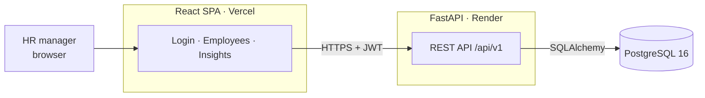
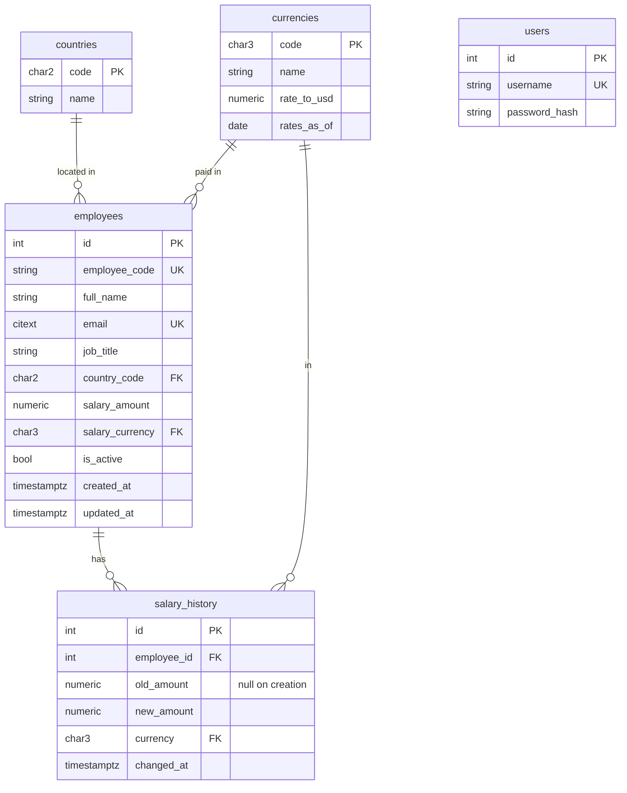

# Design

How the system is put together, how data is modelled, and how the main flows work. The reasoning behind individual choices is recorded in [`decisions/`](decisions/).

## Architecture



- **Frontend:** a static single-page app. TanStack Query caches server data; MUI DataGrid renders the employee table with server-side pagination.
- **Backend:** a stateless JSON API. Every route except login requires a valid JWT.
- **Database:** the single source of truth for employees, salaries, history and exchange rates.

## Backend layers

```
backend/app/
├── api/        HTTP only: routing, status codes, query validation
├── schemas/    Pydantic request/response models (the API contract)
├── services/   business rules and SQL composition
├── models/     SQLAlchemy tables
└── core/       configuration, database session, security (JWT, password hashing)
```

Requests flow `api → services → models`. Routers stay thin so business rules (salary history, currency lock, active-only insights) live in services, where they are unit-tested without HTTP.

## Data model



| Table | Notes |
|---|---|
| `employees` | `employee_code` (`EMP-000123`) is generated by the database from `employee_code_seq`, so concurrent creates never collide. `salary_amount` is `NUMERIC(14,2)` in the employee's local currency and must be positive. `salary_currency` is independent of country and fixed after creation. `is_active` replaces deletion. |
| `salary_history` | One row per salary change; its own primary key, so an employee can have many rows. The first row (`old_amount` null) records the starting salary. |
| `currencies` | Static snapshot: `rate_to_usd` is `NUMERIC(20,8)`; `rates_as_of` is shown in the UI. |
| `users` | The HR manager's login. |

**Indexes**

| Index | Serves |
|---|---|
| `employees (is_active, country_code, job_title)` | Insights and the country filter, which always filter on active employees first |
| `employees (employee_code)`, `employees (email)` (unique) | Uniqueness and lookup |
| `salary_history (employee_id, changed_at)` | One employee's history, newest first |

## Key flows

**List employees.** `GET /employees` takes `search` (name, email or code), `country`, `status` (`active` by default, `inactive` or `all`), `sort` (`name`, `country` or `salary`), `order` and page parameters. The service builds one SQL query that joins `currencies` to compute the USD amount, applies filters and sorting in the database, then paginates. Sorting by salary uses the USD amount so different currencies rank correctly, and `id` breaks ties so pages never overlap or skip employees who share a name.

**Create an employee.** In one transaction: insert the employee (the database assigns the code), then insert a `salary_history` row with `old_amount = NULL` and `new_amount` = starting salary. A duplicate email returns 409; an unknown country or currency returns 422.

**Update an employee.** `PATCH /employees/{id}`, in one transaction:
1. Load the employee.
2. Reject the request if it changes `salary_currency`.
3. If `salary_amount` changes, insert a `salary_history` row (old → new) and update the employee.

**Deactivate or reactivate an employee.** `PATCH /employees/{id}` with `is_active`. The row and its history remain.

**Insights.** Each endpoint is one `GROUP BY` query over active employees, converting salaries to USD in SQL (`salary_amount × rate_to_usd`) and rounding only the final aggregate:

| Endpoint | Answers |
|---|---|
| `GET /insights/by-country` | Headcount, min, max and average pay per country |
| `GET /insights/by-title?country=` | Average pay per job title in a country, highest first (the first rows are the top-paying titles) |
| `GET /insights/title-comparison?title=` | How one job title is paid across countries, highest first |
| `GET /insights/distribution?country=` | p25 / median / p75 / p90 via `percentile_cont`; null percentiles when a country has no active employees |
| `GET /insights/job-titles` | Titles in use, for the comparison picker |

**Known limitation:** job titles are free text, so differently written titles ("software engineer" vs "Software Engineer") form separate groups. A managed list of job titles would fix this and is out of scope for the first release.

## Testing approach

- **Backend:** pytest against a dedicated Postgres test database built by running the migrations, so tests see exactly the production schema and SQL features such as `percentile_cont` and `CITEXT` are tested for real. Each test runs in a rolled-back transaction to stay fast and isolated.
- **Frontend:** vitest + Testing Library, with MSW mocking the API at the network layer.
